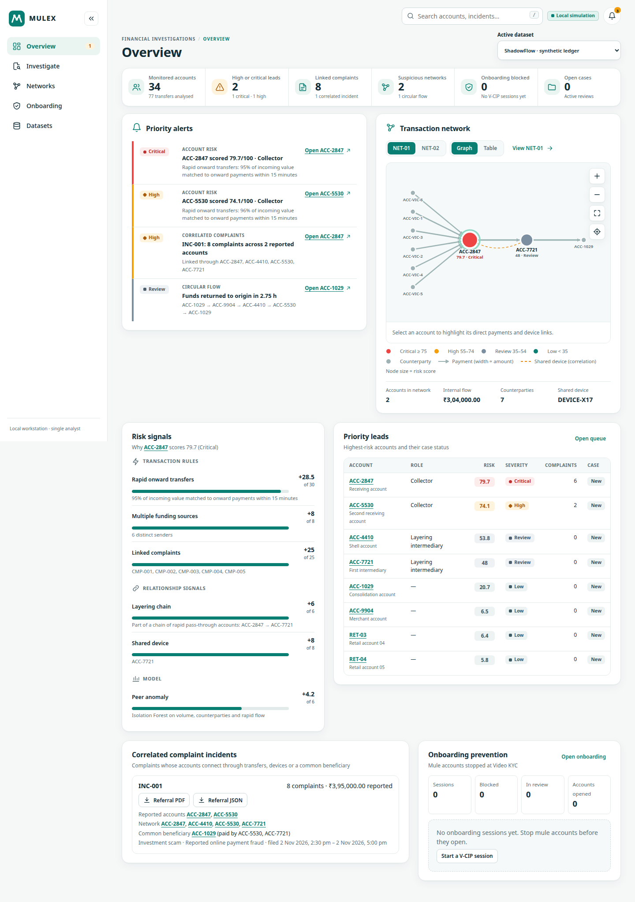
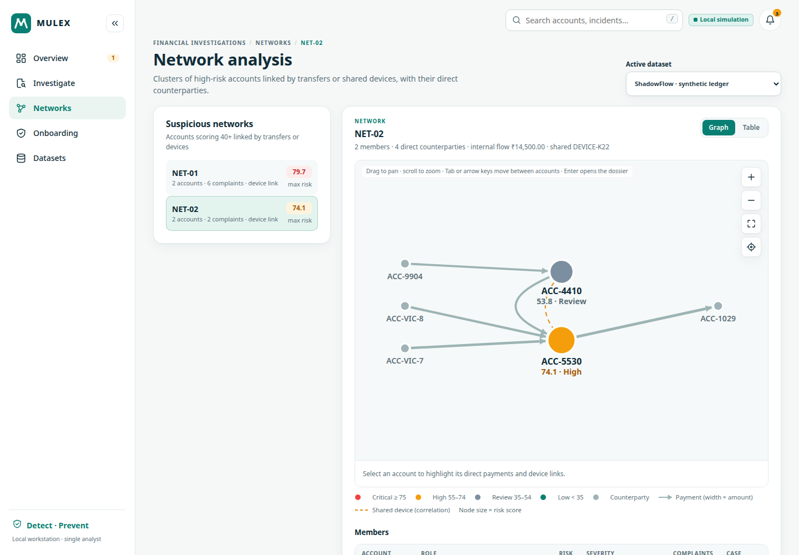
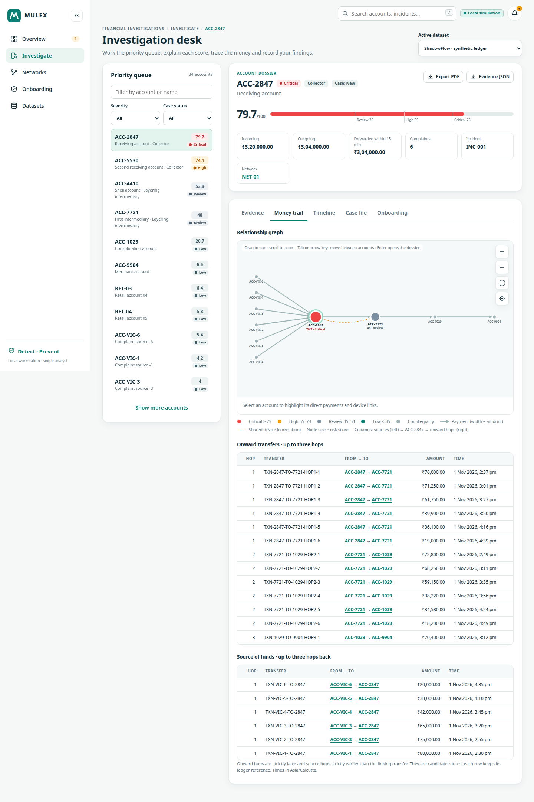
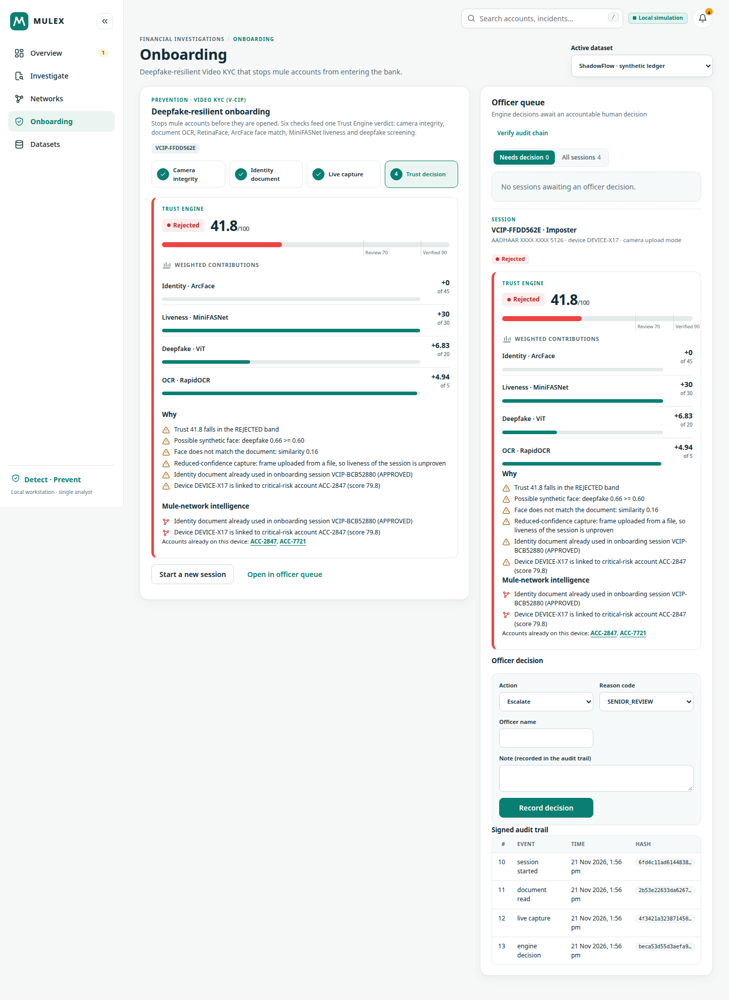

# MULEX — mule account detection and prevention

MULEX finds the mule accounts already inside a bank and stops new ones from getting in. It works the way an intrusion detection and prevention pair (IDS + IPS) does for networks:

- **Detect.** Transaction behaviour, complaints, shared devices and fund-flow structure produce an explainable risk score for every account. MULEX also finds layering chains, circular flows, correlated complaint incidents and suspicious networks.
- **Prevent.** Mule accounts are usually opened remotely through Video KYC (V-CIP) with stolen identities, injected video and deepfakes. MULEX's onboarding pipeline sits between the applicant's browser and the officer's decision: a camera-integrity gate, document OCR, RetinaFace, ArcFace face matching, MiniFASNet liveness and deepfake screening feed one explainable Trust Engine verdict. It also checks each applicant against the detection graph (reused identity, a face enrolled under another identity, a device used by a known mule) before any account is opened.

Each finding is evidence an investigator can follow: a ledger transfer ID, complaint reference or device link. Case files and PDF/JSON exports keep the investigation reproducible.

| PS-01 requirement | Where it is in MULEX |
| --- | --- |
| Transaction analysis | Rapid pass-through (15-minute FIFO matching), layering chains, departure from the account's own history, fan-in/fan-out, Isolation Forest peer anomaly |
| Mule account detection | Dynamic 0–100 risk score, Critical/High/Review/Low levels, a ranked queue, per-indicator contributions with evidence, and an inferred role (collector, layering intermediary, cash-out endpoint) |
| Money trail analysis | Time-ordered onward trace and source-of-funds trace (three hops each), time-ordered circular-flow detection |
| Complaint correlation | Complaints linked to accounts and transfers, grouped into incidents across accounts joined by transfers, shared devices or a common beneficiary |
| Graph-based investigation | **Networks** view with a graph for each cluster, plus a relationship graph in each account dossier |
| Investigation dashboard | **Overview** with KPIs, a risk-based alert feed and incidents; transaction timeline; case file; PDF brief and JSON evidence export |
| Prevention (our addition) | **Onboarding**: deepfake-resilient V-CIP with a camera-integrity gate, document OCR, face match, liveness, deepfake screening, the Trust Engine (45/30/20/5 weights, 90/70 bands), mule-network checks against the detection graph, officer decisions with reason codes, and a hash-chained, HMAC-signed audit trail |
| Coordination with law enforcement | Incident referral pack (PDF and JSON) with accounts, scores and reasons, complaints, every transfer touching the network, circular flows, and a ledger digest |

**Evaluator setup:** use the repository root on a Windows x64 or Linux x86-64 workstation. One Python process serves the dashboard and API. The first launch creates a SQLite database and opens with the synthetic **ShadowFlow** investigation. The main dashboard works offline after installation.

## Windows installation

1. Download and extract the repository ZIP, or clone the private repository. Open PowerShell in the directory containing `pyproject.toml` and `uv.lock`.
2. Install **uv** if needed. After installing, reopen PowerShell in the same directory so Windows picks up the updated PATH. [Official uv installation guide](https://docs.astral.sh/uv/getting-started/installation/)

   ```powershell
   winget install --id astral-sh.uv --exact
   ```

3. Install the locked runtime and start the workbench. uv will obtain 64-bit Python 3.13 if needed.

   ```powershell
   uv sync --locked --no-dev --no-build --python 3.13
   .\.venv\Scripts\python.exe -m app
   ```

4. Open [MULEX on this computer](http://127.0.0.1:8000). Keep PowerShell open while reviewing. Press **Ctrl+C** to stop. On later runs, repeat only the command ending in `-m app`.

## Linux installation

1. Download and extract the repository ZIP, or clone the private repository. Open a terminal in the directory containing `pyproject.toml` and `uv.lock`. Use an x86-64 glibc distribution such as Ubuntu 24.04.
2. Install **uv** if needed. The second command makes the default user installation available in the current shell. [Official uv installation guide](https://docs.astral.sh/uv/getting-started/installation/)

   ```sh
   curl -LsSf https://astral.sh/uv/install.sh | sh
   export PATH="$HOME/.local/bin:$PATH"
   ```

3. Install the locked runtime and start the workbench.

   ```sh
   uv sync --locked --no-dev --no-build --python 3.13
   .venv/bin/python -m app
   ```

4. Open [MULEX on this computer](http://127.0.0.1:8000). Keep the terminal open while reviewing. Press **Ctrl+C** to stop. On later runs, repeat only the command ending in `-m app`.

The first installation needs internet access for the interpreter and packages. The application runs on CPU, serves its own dashboard assets, and requires no API key, Node.js installation or external database. Its launcher binds to the local workstation. The [health endpoint](http://127.0.0.1:8000/api/health) returns `status: ready` after initialization and reports which onboarding models are loaded.

## Five-minute evaluator walkthrough

| Step | What to do | What to check |
| --- | --- | --- |
| 1. Triage | Open **Overview** in **ShadowFlow**. | The alert feed lists ACC-2847 as Critical, then ACC-5530. Incident **INC-001** correlates 8 complaints against two reported accounts. They are linked because both mule chains pay the common beneficiary ACC-1029. A circular-flow alert shows funds returning to ACC-1029 within 2.75 h. |
| 2. Map the network | Open **Networks**. Select **NET-01**, then **NET-02**. | Each graph shows network members (inner ring, sized by risk) and their direct counterparties (outer ring). Dashed lines show shared devices DEVICE-X17 and DEVICE-K22. The ring table lists the transfer IDs that close the loop. |
| 3. Explain a score | Select **ACC-2847** and open **Evidence**. | Six complaints link to individual incoming transfers. The account receives ₹3,20,000 and forwards ₹3,04,000 within 15 minutes. The role is **Collector**. The contributions, including **Layering chain**, sum to the score. |
| 4. Trace the money | Open **Money trail**, then **Timeline**. Repeat for **ACC-5530**. | The onward trace runs ACC-7721 → ACC-1029 → ACC-9904. The source-of-funds trace for ACC-5530 shows victims ACC-VIC-7 and ACC-VIC-8, and funds that came round the ring through ACC-4410. |
| 5. Investigate | In **Case file**, enter an analyst name, select **Escalated**, add a finding and save. Export the PDF and evidence JSON. | The account appears under the **Escalated** queue filter. Both exports include the case history, the correlated incident, the source trail and the SHA-256 digest of the ledger snapshot. |
| 6. Refer | On **Overview**, in **INC-001**, select **Referral PDF** and **Referral JSON**. | The referral PDF and JSON list every account, its score contributions, the 8 complaints, all transfers touching the network and the ledger SHA-256. |
| 7. Prevent a mule account | Open **Onboarding**. Enter a name, choose **Live camera** (or **Upload images** without a webcam) and start. Upload the identity document, capture a frame and submit. | Six checks run on CPU in under a second per frame. The Trust Engine shows each weighted contribution, the band and every reason. The session appears in the **Officer queue**. Approving it opens a monitored account (ACC-ONB-…) in the dataset; its dossier shows the onboarding record. |
| 8. Attack it | Start new sessions under **Evaluator simulation**: (a) tick *Report an "OBS Virtual Camera" device*; (b) set the device fingerprint to **DEVICE-X17**; (c) reuse the same document with a different face. | (a) Rejected before the session opens. (b) Flagged: the device belongs to critical-risk mule ACC-2847. (c) Rejected for face mismatch and flagged for identity-document reuse. **Verify audit chain** confirms every decision is signed and untampered. |
| 9. Change the evidence | In **Datasets**, download the example CSV and import it. Open **B** and record a new complaint against **T3**. | In the new ledger, B received ₹3,600 and sent ₹3,450. The complaint updates B’s explanation and changes its counterparties’ scores. ShadowFlow remains available in the dataset selector. |









## Try a judge-supplied dataset

Upload UTF-8 CSV or JSON through **Datasets**. Enter amounts as positive integer INR paise, so `125050` means ₹1,250.50. Timestamps must include a timezone, such as `2026-11-01T09:00:00+05:30`. Identifiers are case-sensitive.

| Format | Contents |
| --- | --- |
| [Transaction CSV](web/transfers.csv) | Exact column names `id,sender,receiver,amount_paise,timestamp`. Each distinct endpoint becomes an account. |
| [Full JSON dataset](examples/shadowflow.json) | A name, accounts, transactions and optional complaints. Accounts can carry a shared device ID. A complaint links to an account and optionally to a transfer involving that account. |

The browser accepts files up to 4 MB. A workspace supports up to 3,000 accounts, 20,000 transfers and 5,000 complaints. Import validation checks identifiers, references and amounts before writing. Reimporting the same validated dataset returns its existing workspace. Change the dataset name to start a separate investigation with the same input.

## How a decision is made

- **Account risk.** A fifteen-minute FIFO window matches incoming value to strictly later outbound payments, and the same incoming paise can count only once. Maximum points per indicator:

  | Indicator | Max points |
  | --- | --- |
  | Rapid onward transfers (share of incoming value forwarded within 15 min) | 30 |
  | Linked complaints (10 each) | 25 |
  | Multiple funding sources | 8 |
  | Shared device | 8 |
  | Layering chain (pass-through account next to another pass-through account) | 6 |
  | Complaint-linked counterparties | 6 |
  | Peer anomaly (Isolation Forest, at least 12 accounts and 4 distinct feature vectors) | 6 |
  | Distribution to multiple recipients | 4 |
  | Circular fund flow | 4 |
  | Departure from the account’s own median transfer | 3 |

  The maximum is 100. Levels are Critical (75 and above), High (55), Review (35) and Low. Scores prioritise investigative leads. The model has no validated real-world fraud accuracy estimate.
- **Roles.** An account forwarding at least half of its incoming value within 15 minutes is a **Collector** if it has three or more senders, otherwise a **Layering intermediary**. An account that keeps more than 80% of funds received from such accounts is a **Cash-out endpoint**.
- **Networks and trails.** NetworkX forms clusters from accounts scoring at least 40 that share a device or a transfer. The onward trace follows strictly later payments, and the source trace strictly earlier payments, for up to three hops each, with up to 140 transfers. Circular flows are directed rings of two to five accounts whose transfers occur in order within 72 hours. These are candidate paths, and each link keeps its ledger reference.
- **Complaint incidents.** Accounts with complaints or a score of at least 35 are joined when they transact, share a device, or both pay the same beneficiary. Each connected group with complaints becomes an incident, with its complaints, reported accounts, categories, reported value and connecting accounts.
- **Case files and exports.** Each case entry records its revision, time, reviewer-entered name, disposition and note. Stale updates prompt a reload. The PDF is a readable brief. The JSON preserves exact timestamps, integer amounts, reasons, complaint references, case revisions and the account's onboarding record. The ledger digest identifies the financial dataset snapshot used for the report.

## Onboarding prevention (V-CIP)

The pipeline is a middleware layer between the customer's browser and the officer's decision. Nothing in the core banking system changes: approval writes the customer record into the active dataset, where the detection engine monitors it like any other account.

| Step | Check | What happens |
| --- | --- | --- |
| 0 | **Camera integrity** (hard gate) | The browser enumerates media devices after camera permission. A known virtual interface (OBS, v4l2loopback "Dummy video device", ManyCam, XSplit, Snap Camera and others), an automated browser (`navigator.webdriver`) or missing permission fails the session before it opens. |
| 1 | **Document OCR** (RapidOCR, PP-OCRv6) | Reads name, date of birth, gender and the Aadhaar or PAN number. Aadhaar numbers are checked with the UIDAI Verhoeff checksum, and PAN structure is validated, so a misread or altered digit goes to review. Numbers are masked (`XXXX XXXX 5126`) and stored only as a keyed hash. |
| 2 | **Face detection** (RetinaFace) | Finds the face and five landmarks on the document and on every live frame. No face, or a cropped document photo, is rejected with guidance. Two or more faces pause the session. |
| 3 | **Liveness** (MiniFASNet v2) | Passive, single frame, no blink prompt: real versus print, screen or replay. |
| 4 | **Deepfake screening** | Generated-face probability. Uses the team's Tiny CNN + ViT when its weights are supplied, otherwise the public CommunityForensics ViT ([details](onnx_models/MODELS.md)). |
| 5 | **Identity** (ArcFace) | 512-D embeddings of the document and live faces, compared by cosine similarity. The operating threshold is 0.40. |
| 6 | **Trust Engine** | `trust = 100 × (0.45·identity + 0.30·liveness + 0.20·(1 − deepfake) + 0.05·OCR)`. At least 90 is **Verified**, 70–89 **Manual review**, below 70 **Rejected**. |

Identity similarity maps linearly to the identity score (0.20 → 0, 0.40 → 0.5, 0.60 or more → 1). Overrides can only make a decision stricter, and each is written into the reasons:

- **Rejected:** liveness below 0.50 (presentation attack); deepfake probability of at least 0.85; face similarity below 0.30.
- **At most manual review:** deepfake of at least 0.60; similarity of 0.30–0.40; any model unavailable; a capture-quality prompt (dark, blurred, small or off-centre face); a document issue (failed checksum, unreadable number); an uploaded rather than live frame; and any mule-network hit.
- **Mule-network intelligence** links prevention to detection: the same identity document in an earlier session, the same face (ArcFace ≥ 0.60) enrolled under a different ID number, a device already used by an account scoring 55 or more, or a device used to onboard other identities.

An officer then approves (opening the account), escalates or rejects, with a reason code and note. A rejected session cannot be approved. Every event is appended to a SHA-256 hash chain and signed with HMAC-SHA256 using a key generated beside the database (`*.audit.key`). **Verify audit chain** recomputes it and reports the first tampered record.

**Privacy.** Document and frame images are processed in memory and never written to disk. The database keeps masked identifiers, keyed hashes, scores, reasons, the birth year and the face embeddings needed to detect face reuse.

### Edge cases from the CyberNova report

How each scenario from the team's earlier prototype report is handled in this repository, and how that was verified here. "Stand-in models" means an automated test with deterministic model outputs; "measured" means a local run of the real models on public-domain portraits and a synthetic specimen card.

| ID | Scenario | MULEX behaviour | Verified by |
| --- | --- | --- | --- |
| TC-01 | Genuine document, same person | Verified when every signal clears; otherwise manual review | Automated (stand-in models). Measured: a genuine portrait went to **manual review** because the public deepfake detector scored it 0.71 |
| TC-02 | ID photo taken years ago | ArcFace match | Measured: photos 8 years apart scored 0.56–0.61 (match) |
| TC-03–05, 07, 24 | Glasses, beard, hairstyle, rotation, expression | ArcFace match | Not separately tested |
| TC-06, 08, 11, 12 | Poor lighting, off-centre, blurred, low resolution | Guidance prompt; submitting anyway caps at manual review | Automated (quality checks); measured for off-centre |
| TC-09 / TC-10 | No face / multiple faces | "Face not detected" / session paused | Automated |
| TC-13–15 | Printed photo, replay video, mobile screen | Liveness below 0.50 rejects | Logic automated. Not tested with physical attacks |
| TC-16 | Real-time deepfake face swap | Deepfake 0.60 or more: review; 0.85 or more: reject | Logic automated. The public model is a weak separator (see [MODELS.md](onnx_models/MODELS.md)) |
| TC-17 / TC-18 | OCR misread / tampered document | Verhoeff and PAN checks send it to review | Automated; measured on the specimen card |
| TC-19 / TC-20 | Camera permission denied / OBS or virtual camera | Gate fails before the session opens | Automated and in the browser |
| TC-21 / TC-22 | Slow CPU / no internet | Quantised models, all local | Measured: about 230 ms per frame and 1 s per document on this workstation's CPU |
| TC-23 | Identical twins | Not distinguishable by face; the officer decides | Not addressed by the models |
| TC-25 | Document face missing or cropped | Upload rejected | Automated |
| New | Reused document, reused face, mule device | Flagged and held at manual review or worse | Automated and in the browser |

## Verify, persist and troubleshoot

From the repository root, run the automated suite on either OS. It uses temporary databases and exercises the same launcher as the evaluator.

```sh
uv sync --locked --no-build --python 3.13
uv run --locked python -m pytest -q
```

GitHub Actions is configured to run the suite on Ubuntu and Windows x64. Tests cover scoring, layering, time-ordered rings, complaint incidents, alerts, source and onward trails, case revisions, PDF and JSON exports, incident referrals, the Trust Engine formula and overrides, camera-gate patterns, Aadhaar and PAN parsing, the onboarding API (including approval, reuse and mule-device detection and audit tampering), and a smoke test that runs every bundled ONNX model on CPU. [Evaluator workflow](.github/workflows/evaluate.yml)

| Situation | Action |
| --- | --- |
| Port 8000 is occupied | Append `--port 8010` to the platform’s `python -m app` command. Open `http://127.0.0.1:8010`. |
| Windows reports a DLL load error | Install the x64 Microsoft Visual C++ redistributable used by ONNX Runtime, then restart the workbench. [ONNX Runtime requirements](https://onnxruntime.ai/docs/install/#requirements) |
| Keep or back up an investigation | The default database is `data/workbench.db`. Stop the running process cleanly before copying the data directory. Source control excludes local investigation data. |
| Start a fresh evaluation | Before launching, set `$env:MULEX_DB = "data/fresh-review.db"` in PowerShell or `export MULEX_DB=data/fresh-review.db` in a Linux shell. Choose an unused filename. Existing workspaces remain available in their original database. |

## Repository map

| Path | Responsibility |
| --- | --- |
| [app/analysis.py](app/analysis.py) | Transaction features, anomaly model, explainable scores, roles, layering, rings, incidents and trails |
| [app/main.py](app/main.py) | Dataset intake, alert feed, dossiers, account and incident exports |
| [app/cases.py](app/cases.py) and [app/storage.py](app/storage.py) | Revisioned case records, migrations and SQLite transactions |
| [app/onboarding/](app/onboarding/) | V-CIP prevention: camera gate, document OCR, face pipeline, Trust Engine, mule-network checks, signed audit and API |
| [onnx_models/](onnx_models/) | Bundled ONNX models, with sources and licences in [MODELS.md](onnx_models/MODELS.md) |
| [web/](web/) and [examples/](examples/) | Dependency-free dashboard (`desk.js` app shell and pages, `onboarding.js` V-CIP flow and officer queue, `graph.js` accessible fund-flow graph, `styles.css` design tokens) and synthetic evaluation data |
| [tests/](tests/) and [uv.lock](uv.lock) | Integration checks and reproducible dependencies |

This repository edition was assembled on 21 November 2026. The supported deployment is a single-analyst workstation. Core-banking and Video KYC vendor integration, multi-user identity and access control, and validation of the models on operational V-CIP and bank data are outside this release.
